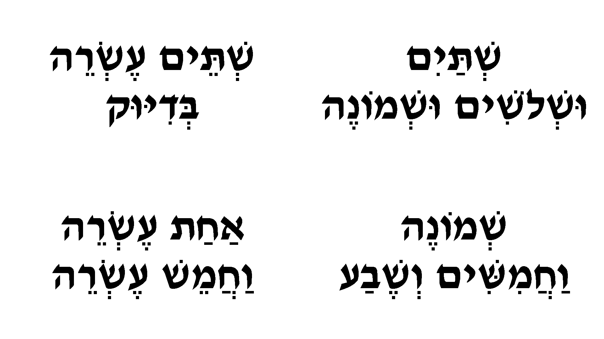
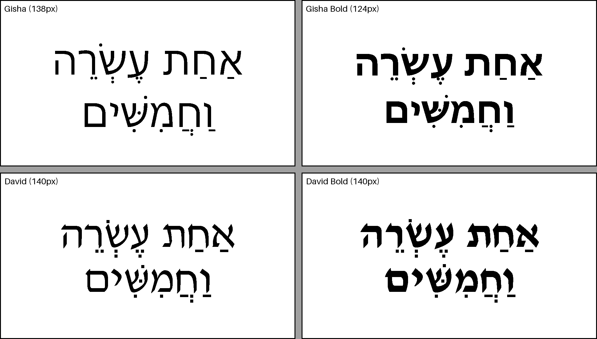

# שעון עברי מנוקד על מסך דיו

שעון שמציג את השעה **במילים, בעברית ובניקוד מלא** על מסך דיו (e-paper) של LILYGO.

<p align="center"></p>

- 21:21 ← **תֵּשַׁע / וְעֶשְׂרִים וְאַחַת**
- 9:00 ← **תֵּשַׁע / בְּדִיּוּק**
- 12:15 ← **שְׁתֵּים עֶשְׂרֵה / וַחֲמֵשׁ עֶשְׂרֵה**

*A Hebrew word clock with full nikud (vowel marks) for the LILYGO T5 4.7" S3 e-paper display. Time comes from NTP over Wi-Fi.*

## מה יש בו

- **ניקוד מלא ונכון דקדוקית**, כולל ו' החיבור לפי הכללים (וְ / וּ / וַ) וצורת סמיכות (שְׁלֹשׁ עֶשְׂרֵה).
- **עדכון חלק בלי הבהוב:** בכל דקה משתנים רק הפיקסלים של המילים שהתחלפו. ניקוי מלא של המסך (עם הבהוב) קורה רק בהדלקה ופעם בלילה ב-03:00, כדי להעלים "צללים".
- **שעון ישראל** כולל מעבר אוטומטי לשעון קיץ/חורף.
- גופן **David Bold**. כל מילה מוכנה מראש כתמונה, כך שהניקוד ממוקם במדויק.

## חומרה

- LILYGO T5 4.7" **S3** (מסך 960×540, ESP32-S3 עם PSRAM). נבדק על לוח עם הסימון Screen-4.7-S3 V2.4.
- כבל USB לחשמל (אין מצב שינה, מיועד לחיבור קבוע).

## התקנה

1. **Arduino IDE:** ב-Boards Manager התקן `esp32 by Espressif Systems` בגרסה **2.0.x** (נבדק על 2.0.11). ספריית המסך לא תומכת ב-3.x.
2. **ספרייה:** התקן את [LilyGo-EPD47](https://github.com/Xinyuan-LilyGO/LilyGo-EPD47) ואת התלויות שלה (SensorLib, Button2).
3. **פרטי רשת:** בתיקייה `HebrewClock` העתק את `secrets.example.h` לקובץ חדש בשם `secrets.h` ומלא שם רשת וסיסמה (רשת 2.4GHz).
4. **הגדרות לוח** (Tools):

| אפשרות | ערך |
|---|---|
| Board | ESP32S3 Dev Module |
| USB CDC On Boot | Enabled |
| Flash Size | 16MB |
| Partition Scheme | 16M Flash (3MB APP/9.9MB FATFS) |
| PSRAM | OPI PSRAM |

5. פתח את `HebrewClock/HebrewClock.ino` וצרוב. אם הצריבה נכשלת: החזק BOOT, לחץ ושחרר RST, שחרר BOOT ונסה שוב.

או משורת הפקודה:

```bash
arduino-cli compile --upload -p COM9 --fqbn "esp32:esp32:esp32s3:CDCOnBoot=cdc,FlashSize=16M,PSRAM=opi,PartitionScheme=app3M_fat9M_16MB" HebrewClock
```

## שינוי הטקסט או הגופן

הטקסט המנוקד נמצא במערכים בראש `HebrewClock.ino`. השעון לא מצייר אותיות בעצמו: הקובץ `HebrewClock/hebrew_words.h` מכיל תמונה מוכנה של כל מילה, שנוצרת במחשב עם HarfBuzz ו-FreeType כדי שהניקוד ימוקם נכון.

אחרי כל שינוי בטקסט העברי או בגופן, צריך לייצר את המילים מחדש:

```bash
pip install uharfbuzz freetype-py pillow numpy
python tools/make_words.py
```

- **גופן:** משנים את `FONT` בראש `tools/make_words.py`. הסקריפט בוחר לבד את הגודל הכי גדול שבו כל השורות נכנסות למסך.
- **השוואת גופנים:** `python tools/compare_fonts.py` יוצר את `docs/fonts_compare.png`.

<p align="center"></p>

## מבנה

| קובץ | תפקיד |
|---|---|
| `HebrewClock/HebrewClock.ino` | התוכנית: Wi-Fi, שעה, ניסוח, ציור ועדכון חלקי |
| `HebrewClock/hebrew_words.h` | תמונות המילים המנוקדות (נוצר אוטומטית) |
| `HebrewClock/secrets.example.h` | תבנית לפרטי הרשת |
| `tools/make_words.py` | מייצר את `hebrew_words.h` ואת התצוגה המקדימה |
| `tools/shape.py` | ציור עברית מנוקדת עם HarfBuzz + FreeType |
| `tools/compare_fonts.py` | השוואה בין גופנים |
